<div align="center">


# Tally

**Count every item. Know every shelf.**
Warehouse inventory and operations for small distributors, from purchase order to barcode label.


[](https://tally.arealjagema.com)

[Features](#features) · [Design](#design) · [Screenshots](#screenshots) · [Tech stack](#tech-stack) · [Getting started](#getting-started)

</div>

<picture>
  <source media="(prefers-color-scheme: dark)" srcset="readme/hero-dark.png">
  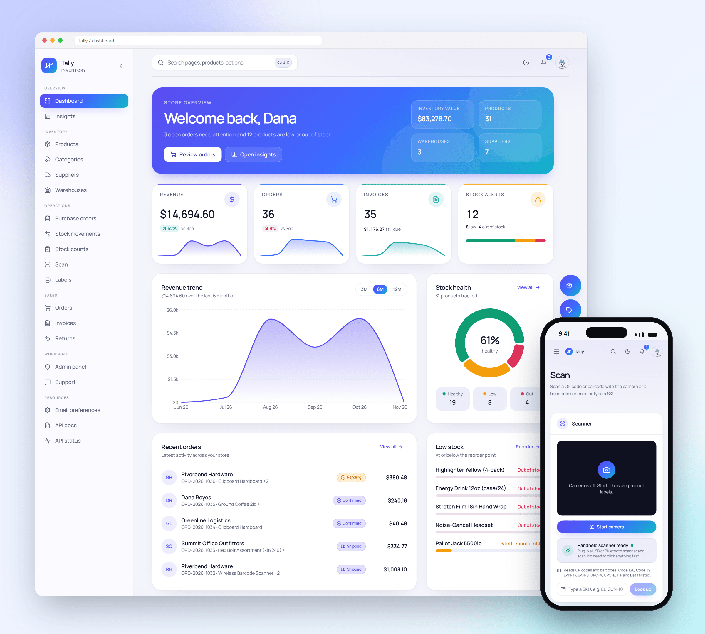
</picture>

## Overview

Tally is a full-stack, multi-role inventory system. A store owner manages the catalog, warehouses and stock operations; suppliers and clients each get their own portal for orders, invoices and support tickets. Every stock change goes through one ledger, so on-hand quantities, warehouse allocations and the movement history always agree.

It runs with nothing more than MongoDB and a JWT secret. Payments (Stripe), shipping labels (Shippo), email (Brevo), image hosting (ImageKit), caching (Upstash Redis) and AI insights switch on when their keys are present.

## Live demo

> **You are on the `demo` branch.** It powers **[tally.arealjagema.com](https://tally.arealjagema.com)** and runs **without a database**: the app serves the built-in Northgate sample store from memory (`lib/demo`). For the real app with MongoDB, use the [`main`](../../tree/main) branch.

Open the site and click **Try demo** on the login page. You sign in as Dana, the owner of *Northgate Supply Co.*: 3 warehouses, 30 products (some low or out of stock), 36 orders with invoices, open purchase orders, stock counts, returns, support tickets and product reviews.

Changes you make are kept in that server's memory only and reset when the demo restarts.

## Features

### Purchase orders and reorder suggestions

Every product at or below its reorder point shows up grouped by supplier, net of reserved stock and what is already on order, with a one-click **Create PO**. Orders move from draft to ordered to partially or fully received, and receiving books stock straight into the ledger.

<picture>
  <source media="(prefers-color-scheme: dark)" srcset="readme/purchase-orders-dark.png">
  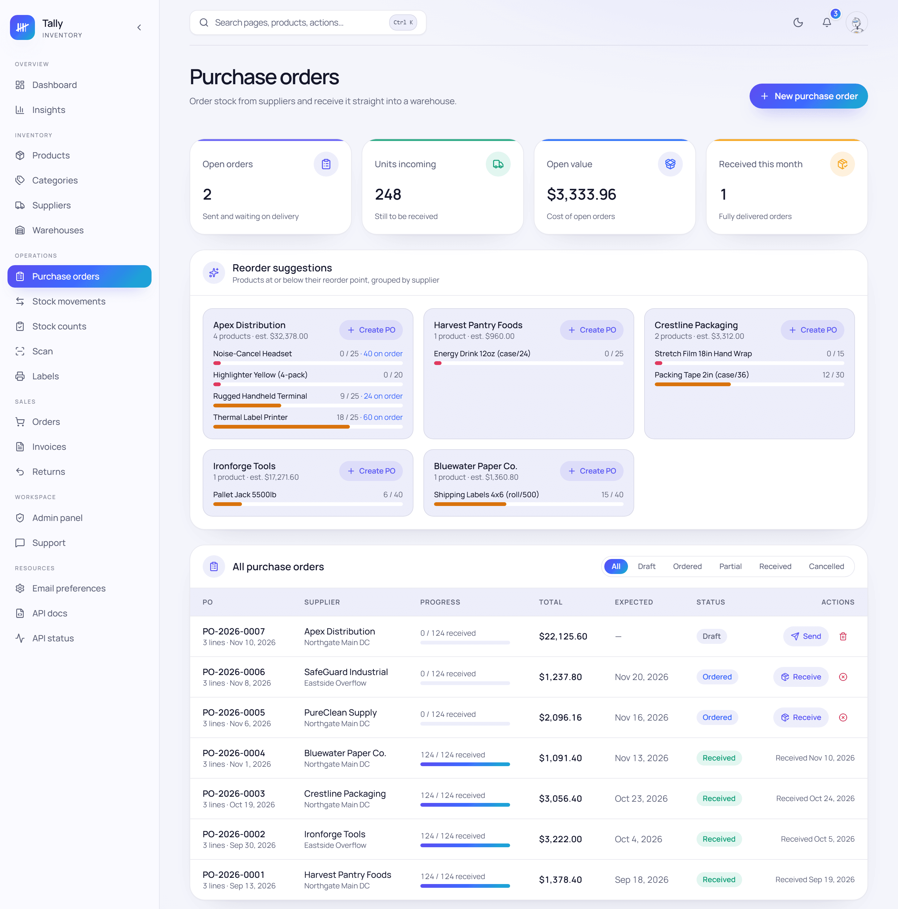
</picture>

### One ledger for every stock change

Receipts, sales, transfers, adjustments, counts and returns all land in a single timeline that says what moved, why, where and who did it, with the running balance after each change.

<picture>
  <source media="(prefers-color-scheme: dark)" srcset="readme/stock-movements-dark.png">
  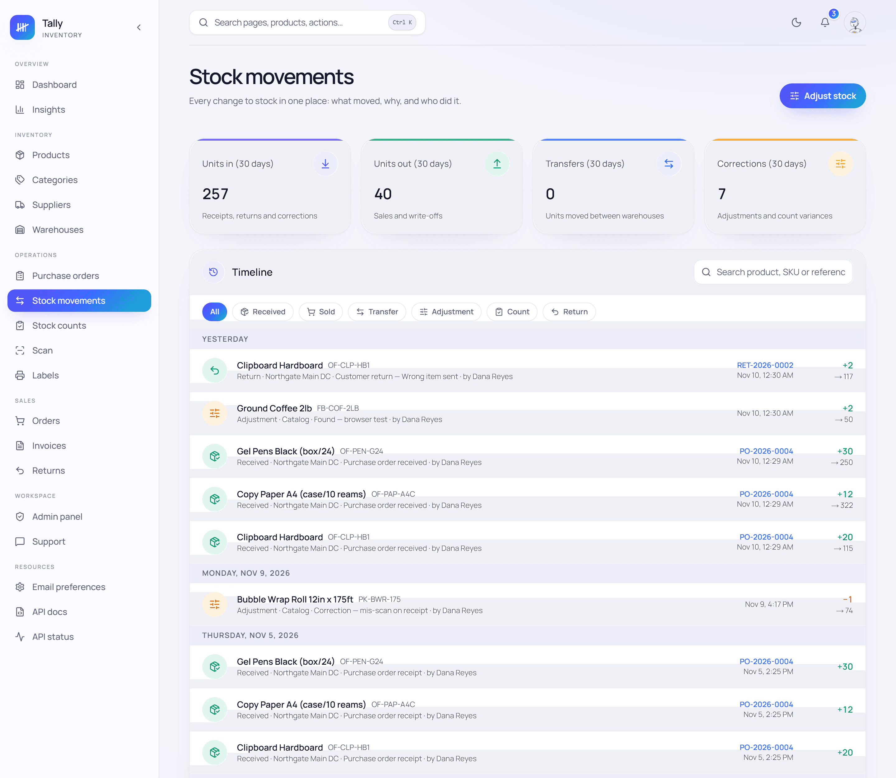
</picture>

### Scan anything, from a phone camera or a USB scanner

`/scan` reads QR codes and 1D barcodes from the camera (jsQR, native `BarcodeDetector`, ZXing fallback) and from handheld scanners, detected as a fast key burst ending in Enter. Unknown codes can be named on the spot, and in-store EAN-13 codes (with a GS1 check digit) print as label sheets.

<picture>
  <source media="(prefers-color-scheme: dark)" srcset="readme/scan-dark.png">
  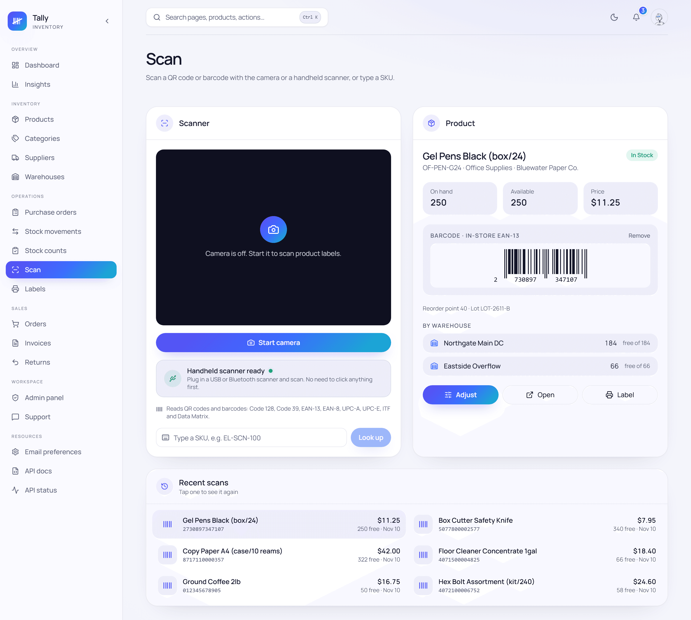
</picture>

### Catalog with live stock status

Products carry SKU, barcode, lot, reorder point and reorder quantity, with filters by status, category and supplier, and CSV/Excel import and export.

<picture>
  <source media="(prefers-color-scheme: dark)" srcset="readme/products-dark.png">
  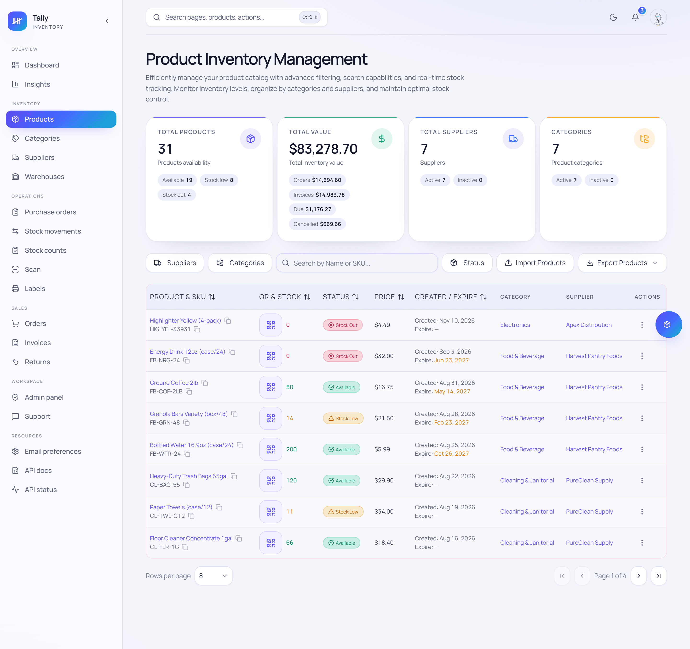
</picture>

### Business insights

Category distribution, product growth, sales and order trends, demand forecasting and optional AI commentary (OpenRouter, with Groq as a fallback).

<picture>
  <source media="(prefers-color-scheme: dark)" srcset="readme/insights-dark.png">
  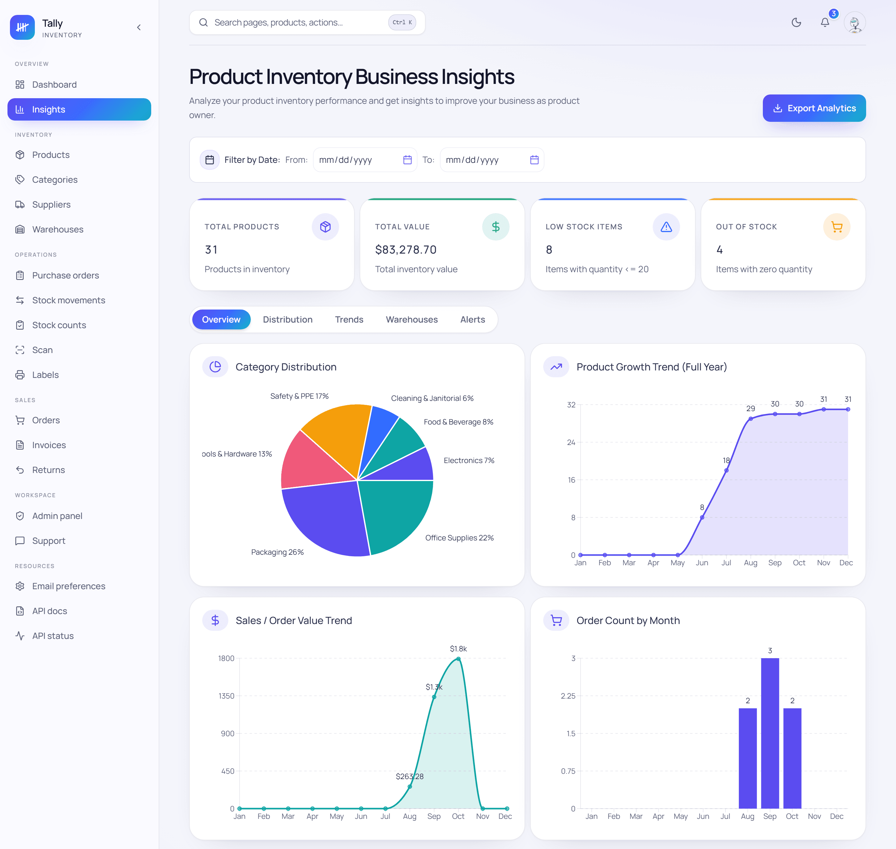
</picture>

### Everything else

| Area | What you get |
|---|---|
| **Warehouses** | Per-warehouse allocations and inter-warehouse transfers |
| **Cycle counts** | Count sheets per warehouse, variance review, then post the adjustments in one step |
| **Returns** | Tied to the original order line, with a restock that can only be applied once |
| **Orders and invoices** | Tax, shipping and discounts, a status pipeline, PDF invoices, email send and partial Stripe payments |
| **Shipping** | Shippo rates, labels and tracking (optional) |
| **Service** | Support tickets with threaded replies, product reviews with an approval queue |
| **Portals** | Client and supplier views scoped to their own orders, invoices and tickets |
| **Navigation** | Grouped, collapsible sidebar, `Ctrl + K` command search, light and dark themes |

## Design

Tally's look is a calm operations UI: slate-lavender surfaces, a single violet-to-teal brand gradient (`#5b4cf0 → #3d6bff → #12b5c9`) reserved for primary actions and the active nav item, and green / amber / red used only for stock and order status. Type is Manrope; numbers sit large in stat cards with a thin accent bar on top so a row of metrics reads at a glance.

- **Tokens, not one-off colours.** Light and dark palettes are shadcn-style HSL variables in `app/globals.css`; charts read the same variables, so a theme switch recolours every chart.
- **Status colour carries meaning only.** A red pill always means out of stock or overdue, never decoration.
- **Built for phones on the warehouse floor.** Checked at 375 px on every operations page: stat tiles shrink, tables keep the first column fixed and scroll sideways, filter chips scroll instead of wrapping, and the sidebar becomes a drawer.
- **Keyboard-first where it matters.** `Ctrl + K` reaches any page or action, and the scan page accepts a scanner's keystrokes without focusing a field.
- **Helpful empty and error states.** Missing optional services (Stripe, Shippo, Brevo) are explained in place instead of failing.

<p align="center">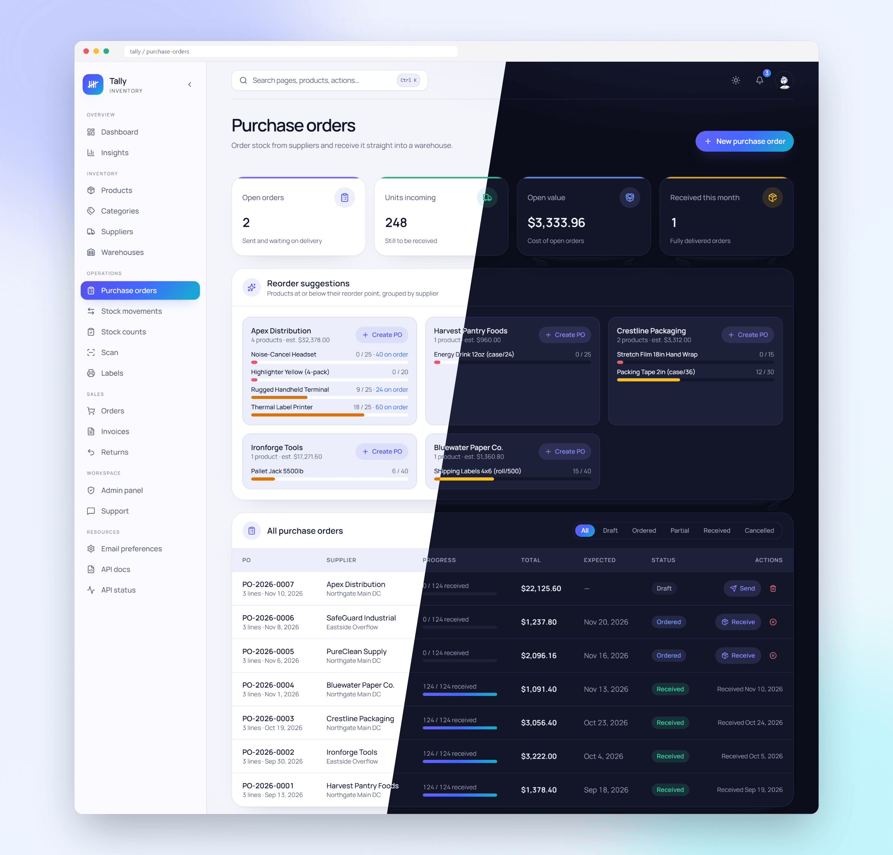</p>

<picture>
  <source media="(prefers-color-scheme: dark)" srcset="readme/mobile-dark.png">
  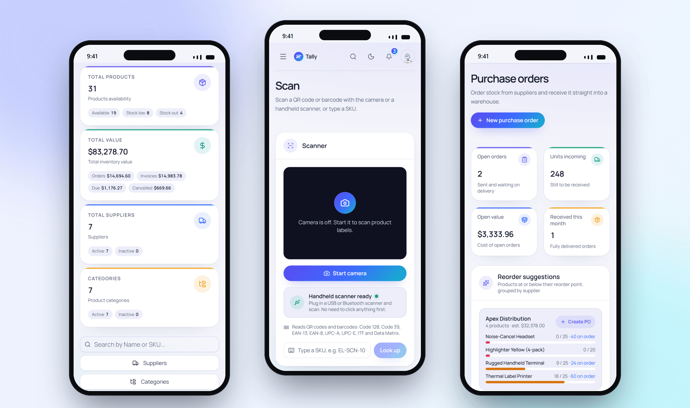
</picture>

## Screenshots

<table>
  <tr>
    <td width="50%">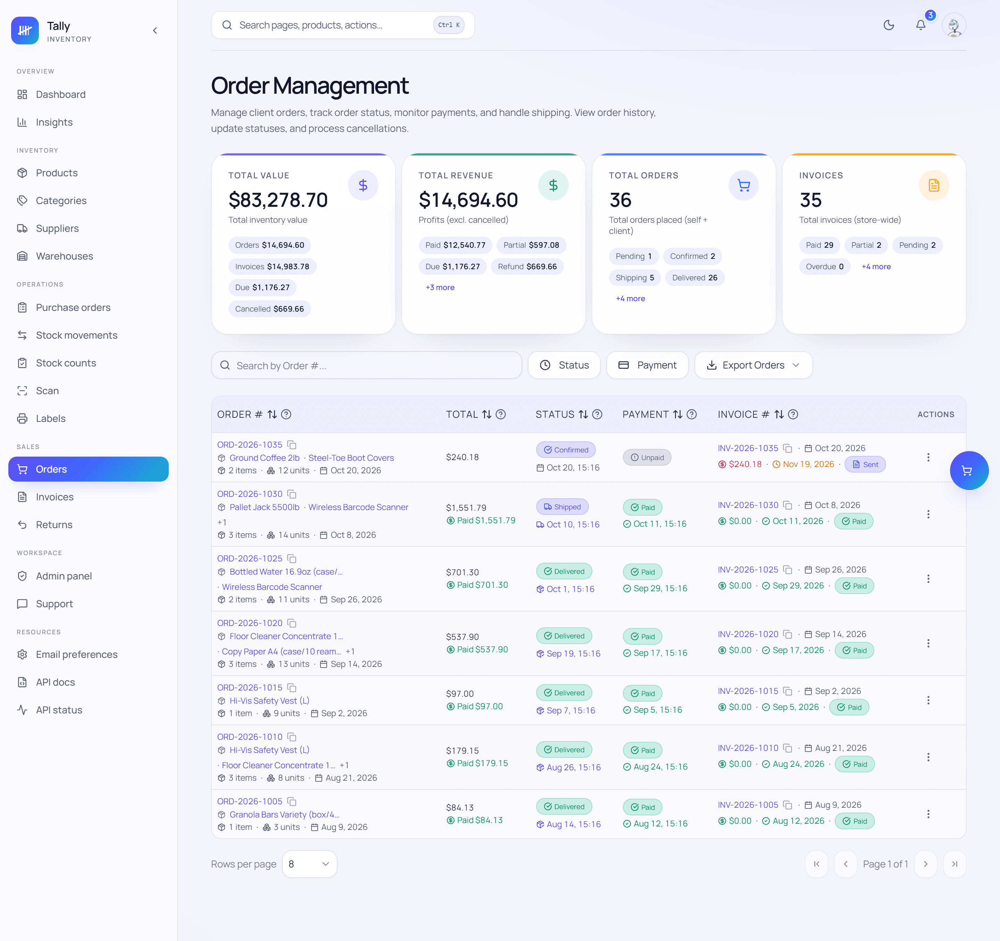<br><sub><b>Orders</b>: revenue, status pipeline and payment state</sub></td>
    <td width="50%">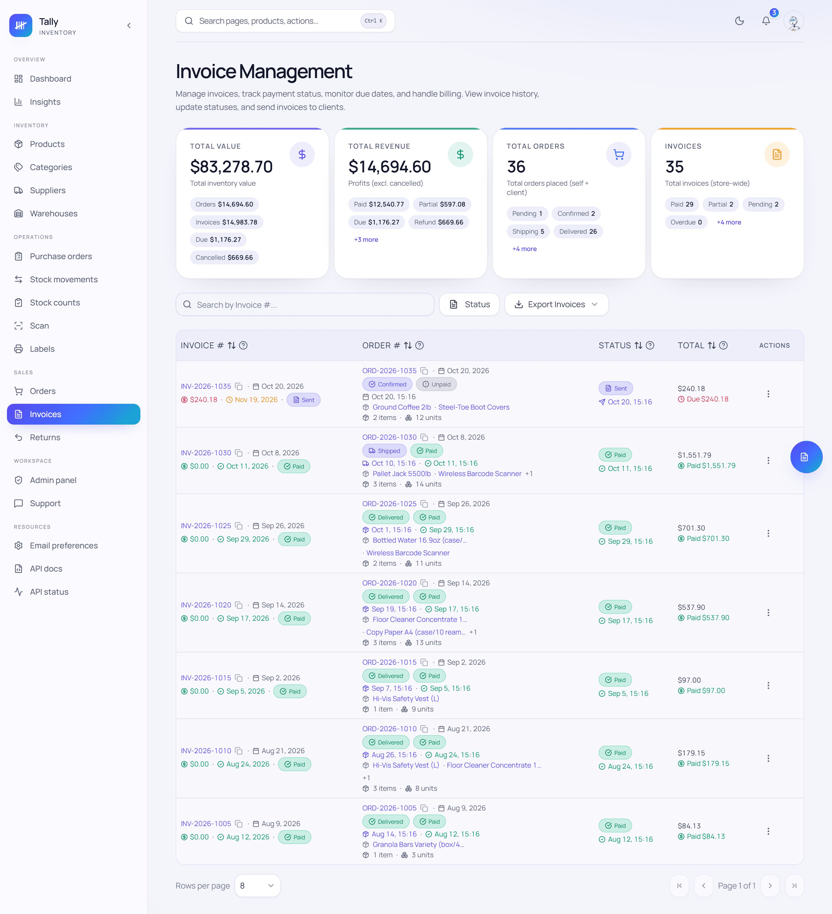<br><sub><b>Invoices</b>: one per order, with due and overdue tracking</sub></td>
  </tr>
  <tr>
    <td width="50%">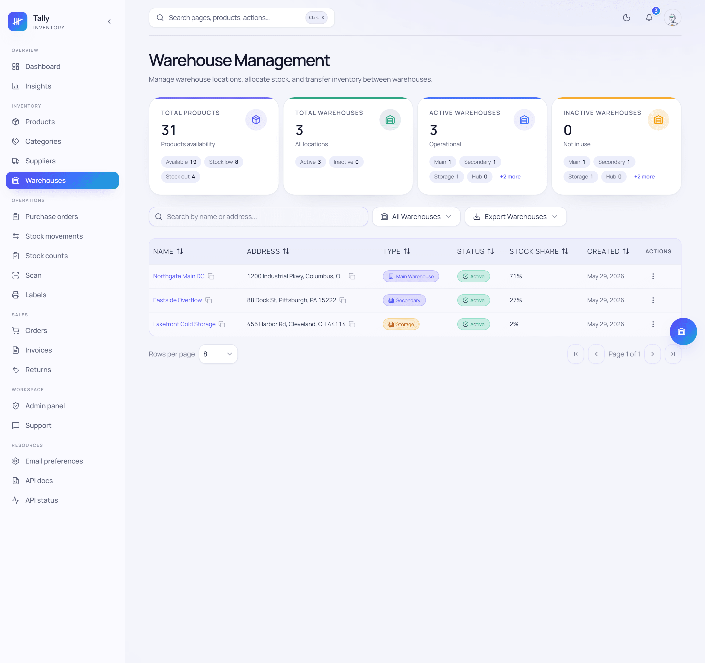<br><sub><b>Warehouses</b>: locations, types and stock share</sub></td>
    <td width="50%">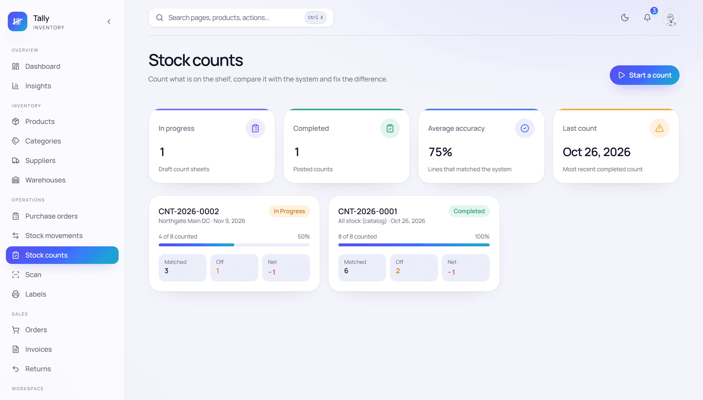<br><sub><b>Stock counts</b>: count sheets and accuracy</sub></td>
  </tr>
  <tr>
    <td width="50%">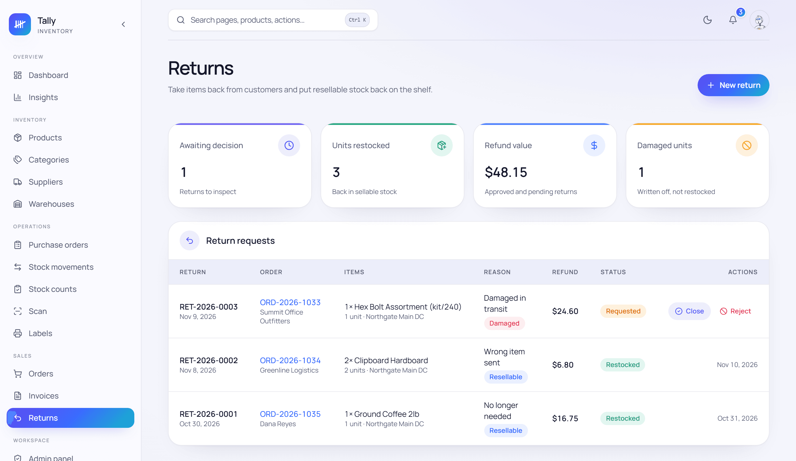<br><sub><b>Returns</b>: decisions, restocks and refunds</sub></td>
    <td width="50%">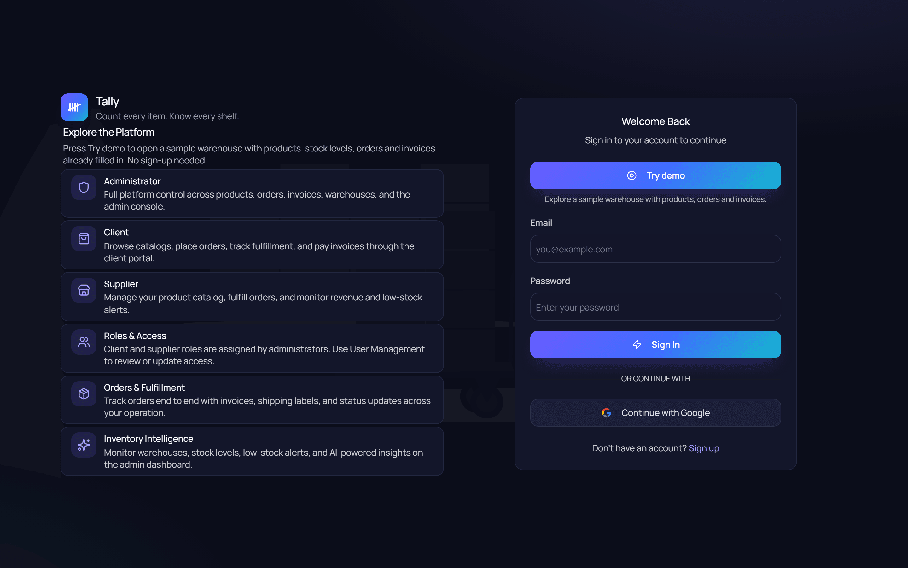<br><sub><b>Login</b> (dark)</sub></td>
  </tr>
</table>

## Tech stack

| Layer | Technology | Why |
|---|---|---|
| Framework | Next.js 16.3 (App Router, Route Handlers, Turbopack) | SSR pages and a REST API in one deployable |
| UI | React 19.2, Tailwind CSS 3.4, shadcn/ui on Radix, next-themes | Accessible primitives, token-based theming |
| Language | TypeScript 5 (strict) | No `any` anywhere, enforced by ESLint |
| Data | MongoDB (replica set), Prisma 6.19 | Flexible documents with a typed client; 27 models |
| Auth | JWT session cookie, bcryptjs, optional Google OAuth | Stateless sessions with role checks per route |
| Server state | TanStack Query 5 | SSR prefetch, then cache patch and targeted invalidation |
| Forms and validation | react-hook-form, Zod 3 | One schema for the form and the API |
| Tables and charts | TanStack Table 8, Recharts 3 | Sortable, filterable tables; themable charts |
| Scanning and labels | jsQR, @zxing/library 0.23, jsbarcode 3.12, qrcode | Camera and label support without native apps |
| Optional services | Stripe, Shippo, Brevo, ImageKit, Upstash Redis and QStash, OpenRouter / Groq | Switched on by env keys |
| Tests | Vitest 4 | 123 files, 836 tests |

## Architecture

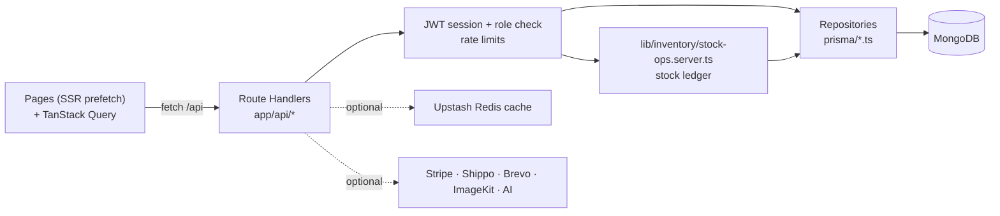

- **SSR first, then a client cache.** Pages prefetch on the server and hydrate into TanStack Query. Mutations patch cached rows immediately, then invalidate every related query, so lists, detail pages and portals stay in sync.
- **One way to change stock.** Receipts, adjustments, counts, returns and transfers all call the same ledger function, which writes a `StockMovement` row alongside the quantity change.
- **Roles, not separate apps.** Admin, supplier and client share one codebase; handlers check the role from the session, and store data is always scoped to the owner's `userId`. Platform-wide user management is limited to `PLATFORM_ADMIN_EMAILS`.
- **Graceful degradation.** Without Redis, caching is off and rate limits fall back to memory; without Brevo, Stripe or Shippo the related buttons explain what is missing.

## Engineering highlights

- **Ledger invariants in one place.** Stock can never go negative, a warehouse can never give up more than its free (unreserved) stock, and every change leaves an audit row with the balance after it.
- **Cache correctness is tested.** A Vitest audit (`lib/react-query/invalidate-coverage.test.ts`) fails when any mutating API route is missing its invalidation entry.
- **Security hardening.** No JWT secret fallback (startup fails without one), 5/min login and register limits per IP, admin-only notification and metrics endpoints, and a shared-secret token on the Shippo webhook.
- **Tenant scoping.** Queries filter by the owner's `userId`, including lookups by id, so a guessed id from another store is simply not found.
- **Lint as a contract.** ESLint enforces no unused variables, no `any` and exhaustive hook dependencies, with zero problems across the repo.
- **No vendor lock for errors.** Production errors go to server logs through one reporting module that can be pointed at any provider.

The ledger checks the product and the warehouse before it touches anything:

```ts
// lib/inventory/stock-ops.server.ts (trimmed)
export async function applyStockDelta(input: StockDeltaInput): Promise<number> {
  const product = await prisma.product.findFirst({
    where: { id: input.productId, userId: input.ownerId, OR: [{ deletedAt: null }, { deletedAt: { isSet: false } }] },
    select: { id: true, quantity: true, reservedQuantity: true, name: true },
  });
  if (!product) throw new InventoryOpError("Product not found", 404);

  const current = Number(product.quantity);
  const next = current + input.delta;
  if (next < 0) throw new InventoryOpError(`Only ${current} of ${product.name} in stock`);

  if (input.warehouseId) {
    // verify the warehouse belongs to the owner, then check free (unreserved) stock
    if (input.delta < 0 && free < -input.delta) {
      throw new InventoryOpError(`Only ${free} free in that warehouse`);
    }
    // update or create the allocation
  }

  await prisma.product.update({ /* quantity: next, status: calculateProductStatus(next) */ });
  await prisma.stockMovement.create({
    data: { userId: input.ownerId, productId: input.productId, type: input.type,
            quantity: input.delta, balanceAfter: next, createdBy: input.actorId /* ... */ },
  });
  return next;
}
```

Handheld scanners are told apart from people by typing speed:

```ts
// hooks/use-keyboard-wedge.ts
const onKeyDown = (e: KeyboardEvent) => {
  if (e.ctrlKey || e.altKey || e.metaKey) return;
  if (isEditable(e.target)) { buffer = ""; return; }   // a text field handles its own keys
  const now = performance.now();
  if (now - last > WEDGE_MAX_KEY_GAP_MS) buffer = "";  // too slow: a person, not a scanner
  last = now;

  if (e.key === "Enter" || e.key === "Tab") {
    if (buffer.length >= WEDGE_MIN_LENGTH) {
      e.preventDefault();
      onScanRef.current(buffer);
    }
    buffer = "";
    return;
  }
  if (e.key.length === 1) buffer += e.key;
};
```

## Getting started

This branch needs no database and no API keys.

```bash
git clone -b demo <your-fork-url> tally-demo
cd tally-demo
npm install
JWT_SECRET=any-long-random-string npm run dev
```

Open `http://localhost:3000/login` and click **Try demo**.

### Deploy (Netlify)

`netlify.toml` holds the build settings. In Netlify, create a site from this repository with **Branch to deploy** set to `demo`, add the environment variable `JWT_SECRET` (a long random string), and add your custom domain under **Domain management**.

<details>
<summary><b>Scripts</b></summary>

| Script | What it does |
|---|---|
| `npm run dev` | Dev server (Turbopack) |
| `npm run build` / `npm start` | Generate the Prisma client, build, serve |
| `npm run lint` | ESLint (no unused vars, no `any`, exhaustive deps) |
| `npm test` | Vitest suite (incl. the in-memory database in `lib/demo`) |

</details>

<details>
<summary><b>Project structure</b></summary>

```
app/
├── (pages)                # dashboard, products, orders, invoices, warehouses,
│                          # purchase-orders, stock-movements, stock-counts,
│                          # returns, scan, labels, business-insights, settings
├── admin/                 # store admin area (portals overview, users, reviews, tickets)
├── client/ supplier/      # role portals
└── api/                   # Route Handlers, one folder per resource
components/                # feature UI (products, orders, warehouses, layouts, ui)
lib/
├── inventory/             # stock ledger, barcode decoder, reorder suggestions
├── react-query/           # query keys, cache patching, invalidation map
├── auth/ server/ cache/   # session, rate limits, Redis helpers
├── forecasting/ ai/       # insights and forecasts
└── demo/                  # in-memory Prisma client, sample-store seed, demo accounts
prisma/
├── schema.prisma          # 27 models (MongoDB on main; in memory on this branch)
├── client.ts              # exports the in-memory client on this branch
└── *.ts                   # repositories
```

</details>

## Testing and quality

```bash
npx tsc --noEmit
npm run lint
npm test
```

- 124 Vitest files (852 tests) covering API schemas and helpers, invoice and payment maths, forecasting, stock operations, formatting, and the cache-invalidation audit.
- ESLint reports zero problems; TypeScript is strict.

## Deployment

This branch deploys to Netlify (see [Deploy (Netlify)](#deploy-netlify)); the only setting it needs is `JWT_SECRET`. Deployment of the real app with MongoDB is documented on the [`main`](../../tree/main) branch.

## Roadmap

- Lot and expiry tracking with FEFO picking.
- Bin locations inside each warehouse and pick lists for orders.
- Automatic purchase-order drafts from reorder suggestions on a schedule.
- Offline-capable scan page (PWA) for warehouse floors with poor signal.
- End-to-end tests (Playwright) for the receive, count and return flows.