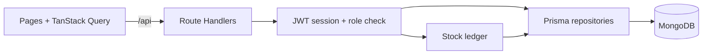

# Tally – inventory tracker


**Count every item. Know every shelf.** Warehouse inventory and operations for small distributors, from purchase order to barcode label.

## Why Tally

Small distributors usually run stock out of a spreadsheet and a lot of memory. Tally puts it in one system with three roles: the store owner runs the catalog, warehouses and stock operations, while suppliers and clients each get a portal for their own orders, invoices and support tickets.

The core rule is simple: **every stock change goes through one ledger.** Receipts, sales, transfers, adjustments, counts and returns all call the same function, which writes a movement row with the balance after it. On-hand quantities, warehouse allocations and the history can't drift apart.

It runs on MongoDB and a JWT secret. Everything else (payments, shipping labels, email, image hosting, caching, AI) switches on when its keys are present, and the UI explains what's missing instead of failing.

## What's Inside

### Stock Operations

- **Purchase orders.** Products at or below their reorder point show up grouped by supplier, net of reserved stock and what's already on order, with a one-click **Create PO**. POs go draft → ordered → partially or fully received, and receiving books stock straight into the ledger.
- **Stock movements.** One timeline of what moved, why, where and who did it, with the running balance.
- **Warehouses.** Per-warehouse allocations and inter-warehouse transfers. A warehouse can never give up more than its free (unreserved) stock.
- **Cycle counts.** Count sheets per warehouse, variance review, then post the adjustments in one step.
- **Returns.** Tied to the original order line, with a restock that can only be applied once.

### Catalog

- SKU, barcode, lot, reorder point and reorder quantity on every product.
- Filters by status, category and supplier.
- CSV and Excel import and export.

### Sales and Service

- Orders with tax, shipping and discounts, a status pipeline, PDF invoices, email send and partial Stripe payments.
- Shippo rates, labels and tracking (optional).
- Support tickets with threaded replies, and product reviews with an approval queue.

### Insights

Category distribution, product growth, sales and order trends, demand forecasting and optional AI commentary (OpenRouter, with Groq as a fallback).

### Everyday Use

Grouped, collapsible sidebar, `Ctrl + K` command search, light and dark themes. Operations pages are checked at 375 px so they work on a phone on the warehouse floor.

## Scanning

`/scan` handles two kinds of input:

- **Phone or laptop camera** – QR codes and 1D barcodes via jsQR, the native `BarcodeDetector`, and a ZXing fallback.
- **USB / handheld scanners** – these act like a keyboard, so Tally spots them as a fast burst of keys ending in Enter. You don't need to focus a field first.

Unknown codes can be named on the spot. In-store EAN-13 codes (with a GS1 check digit) print as label sheets.

## How It Holds Together



- **SSR first, then a client cache.** Pages prefetch on the server and hydrate into TanStack Query. Writes patch cached rows right away, then invalidate every related query.
- **Roles, not separate apps.** Admin, supplier and client share one codebase. Handlers check the role from the session, and store data is always scoped to the owner's `userId`, including lookups by id, so a guessed id from another store just isn't found.
- **Ledger rules in one place.** Stock can never go negative, and every change leaves an audit row with the balance after it.
- **Locked-down basics.** Login and register are limited to 5/min per IP, admin endpoints stay admin-only, and the Shippo webhook needs a shared-secret token.

## Run Locally

**Prerequisites:** Node.js 24, npm, and MongoDB 7 running as a replica set (Prisma needs one on MongoDB). Docker is the quickest way:

```console
$ docker run -d --name tally-mongo -p 127.0.0.1:27017:27017 mongo:7 --replSet rs0 --bind_ip_all
$ docker exec tally-mongo mongosh --quiet --eval "rs.initiate()"
```

**Install and seed:**

```console
$ git clone <your-fork-url> tally
$ cd tally
$ npm install
$ cp .env.example .env
$ npx prisma db push
$ npm run seed:demo
$ npm run dev
```

`seed:demo` builds the demo store and its operations data, and it's safe to re-run.

Open `http://localhost:3000/login` and click **Try demo**. You sign in as Dana, owner of *Northgate Supply Co.*: 3 warehouses, 30 products (some low or out of stock), 36 orders with invoices, open purchase orders, stock counts, returns and tickets. The dashboard should greet you with "Welcome back, Dana" and 12 stock alerts.

## Environment

Three variables are required; the rest are optional switches.

| Variable | Required | Description |
|---|---|---|
| `DATABASE_URL` | Yes | e.g. `mongodb://127.0.0.1:27017/tally?replicaSet=rs0&directConnection=true` |
| `JWT_SECRET` | Yes | Long random string for session tokens. No fallback: startup fails without it |
| `NEXT_PUBLIC_API_URL` | Yes | Base URL, e.g. `http://localhost:3000` |
| `PLATFORM_ADMIN_EMAILS` | No | Emails allowed to manage all users |
| `STRIPE_API_KEY`, `STRIPE_WEBHOOK_SECRET` | No | Invoice payments |
| `SHIPPO_API_KEY`, `SHIPPO_WEBHOOK_SECRET` | No | Shipping rates, labels and tracking |
| `BREVO_API_KEY` | No | Transactional email |
| `UPSTASH_REDIS_REST_URL`, `UPSTASH_REDIS_REST_TOKEN` | No | Response cache and distributed rate limits |
| `OPENROUTER_API_KEY`, `GROQ_API_KEY` | No | AI business insights |

Without Redis, caching is off and rate limits fall back to memory. Without Stripe, Shippo or Brevo, the related buttons explain what's missing.

Other optional groups (`IMAGEKIT_*` for product images, `QSTASH_*` for the email queue, `GOOGLE_CLIENT_ID` / `GOOGLE_CLIENT_SECRET` for Google sign-in, `INTERNAL_API_KEY` for cron calls like invoice reminders) work the same way: set them and the feature turns on.

## Scripts

| Script | What it does |
|---|---|
| `npm run dev` | Dev server (Turbopack) |
| `npm run build` / `npm start` | Generate the Prisma client, build, serve |
| `npm run lint` | ESLint (no unused vars, no `any`, exhaustive deps) |
| `npm test` | Vitest suite: 123 files, 836 tests |
| `npm run test:invalidate` | Only the cache-invalidation coverage audit |
| `npm run seed:demo` | Seed the demo store and operations data |
| `npm run prisma:studio` | Browse the data |
| `npm run script:reset-demo-db` | Reset the demo database |

The invalidation audit is worth a mention: it fails if any mutating API route is missing its cache invalidation entry, so lists, detail pages and portals don't go stale after a write.

Before pushing:

```console
$ npx tsc --noEmit
$ npm run lint
$ npm test
```

ESLint reports zero problems and TypeScript runs in strict mode with no `any`.

The 836 tests cover API schemas, invoice and payment maths, forecasting, stock operations and formatting.

## Project Layout

```
app/
├── (pages)            # dashboard, products, orders, invoices, warehouses,
│                      # purchase-orders, stock-movements, stock-counts,
│                      # returns, scan, labels, business-insights, settings
├── admin/             # store admin area
├── client/ supplier/  # role portals
└── api/               # Route Handlers, one folder per resource
components/            # feature UI
lib/
├── inventory/         # stock ledger, barcode decoder, reorder suggestions
├── react-query/       # query keys, cache patching, invalidation map
└── forecasting/ ai/   # insights and forecasts
prisma/
├── schema.prisma      # 27 models (MongoDB)
└── *.ts               # repositories
scripts/               # seeders and maintenance scripts
```

## Deploying

Tally targets Vercel (`vercel.json` included) or any Node 24 host:

```console
$ npm run build
$ npm start
```

- Use MongoDB Atlas for `DATABASE_URL`; it's a replica set by default.
- Set `JWT_SECRET`, `NEXT_PUBLIC_API_URL` and `NEXT_PUBLIC_APP_URL`, then add optional keys as you need them.
- Point the Stripe webhook at `/api/payments/webhook`.
- Point the Shippo webhook at `/api/shipping/webhook?token=<SHIPPO_WEBHOOK_SECRET>`.